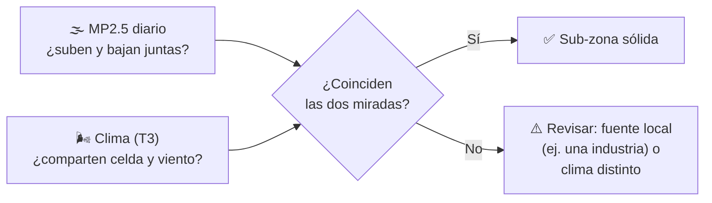

# Registro de decisiones: esquema predictivo y sub-zonas (T1)

**Proyecto:** Predicción de episodios críticos de MP2.5 en el Gran Concepción
**Fecha:** 16 de noviembre de 2026
**Tarea de la Carta Gantt:** T1 (Definición del esquema predictivo y de las sub-zonas)
**Estado:** 🟡 Propuesta, pendiente de validar con datos y con el equipo

---

## 1. La pregunta de la tesis

> ¿Un único modelo para toda la cuenca, como el que usa hoy la autoridad, **esconde episodios locales** que modelos por sub-zona o por estación sí podrían anticipar?

Para responderla se comparan modelos a distinta escala espacial **contra los mismos objetivos**.

---

## 2. Divisiones consideradas

| División | Qué es | Decisión | Por qué |
|---|---|---|---|
| **Cuenca** | Un solo modelo para toda la zona saturada | ✅ Se usa (nivel 1) | Es la línea base y equivale a cómo gestiona hoy la autoridad |
| **Sub-zonas** | Grupos de estaciones que se comportan parecido | ✅ Se usa (nivel 2) | Es el aporte central de la tesis |
| **Estación** | Un modelo por estación | ✅ Se usa (nivel 3), solo si tiene suficientes episodios | Máximo detalle local |
| **Comuna** | División administrativa | ❌ Se descarta | La contaminación no respeta límites comunales, y como la mayoría de las comunas tiene 1 estación, termina siendo igual al nivel estación |
| **Climatológica** | Agrupar por clima | ➡️ Se usa como **evidencia** para definir las sub-zonas, no como un nivel aparte | Ver sección 3 |

---

## 3. ¿Qué significa "comportarse parecido"?

Dos estaciones pertenecen a la misma sub-zona si **su contaminación sube y baja los mismos días**. No basta con que estén cerca, ni con que estén en la misma comuna.

Se revisa con **dos miradas**, una sobre el efecto y otra sobre la causa:

| Mirada | Pregunta | Cómo se mide | Fuente |
|---|---|---|---|
| 🌫️ **Contaminación** (efecto) | ¿Tienen episodios los mismos días? | Correlación del MP2.5 diario entre estaciones + agrupamiento jerárquico (dendrograma) + coincidencia de días con episodio | `dataset_limpio.parquet` |
| 🌬️ **Clima** (causa) | ¿Reciben el mismo clima? | Celda meteorológica compartida y correlación de viento | Informe de resolución (T3) |



**Interpretación:**
- **Las dos miradas coinciden:** la sub-zona queda bien justificada.
- **Mismo clima pero contaminación distinta:** probablemente hay una **fuente local**, como una industria cercana. Es un hallazgo interesante para la tesis.
- **Clima distinto pero contaminación parecida:** puede haber transporte de contaminación entre zonas.

### Lo que ya sabemos por el lado del clima (T3)

Las 18 estaciones caen en 7 celdas meteorológicas:

| Celda | Estaciones | Sub-zona a priori |
|---|---|---|
| 1 | Lota rural, Lota urbana | Coronel-Lota |
| 2 | Cerro Merquín, Coronel Norte, Lagunillas, Escuadrón ENEL, Escuadrón ENESA | Coronel-Lota |
| 3 | Punteras | Valle |
| 4 | Hualqui | Valle |
| 5 | JUNJI, Bocatoma, ENAP Price, Kingston College | Talcahuano-Hualpén + Valle |
| 6 | San Vicente, Inpesca, Indura, Nueva Libertad | Talcahuano-Hualpén |
| 7 | Liceo Polivalente | **Tomé (sin sub-zona a priori)** |

Falta la mirada de la contaminación (sección 6).

---

## 4. Propuesta: 3 niveles de modelo

```
Nivel 1  CUENCA       → 1 modelo
Nivel 2  SUB-ZONAS    → 3-4 modelos (definidas con la sección 3)
Nivel 3  ESTACIÓN     → 1 modelo por estación con suficientes episodios
```

### Opciones de sub-zonas (a validar con datos)

| | Opción 1 · Original (3) | ⭐ Opción 2 · Recomendada (4) | Opción 3 · Fina (5) |
|---|---|---|---|
| **Sur industrial** | Coronel + Lota (7) | Coronel + Lota (7) | Coronel (5) |
| | | | Lota (2) |
| **Norte industrial-portuario** | Talcahuano + Hualpén (7) | Talcahuano + Hualpén (7) | Talcahuano + Hualpén (7) |
| **Valle urbano** | Concepción + Chiguayante + Hualqui (3) | Concepción + Chiguayante + Hualqui (3) | Concepción + Chiguayante + Hualqui (3) |
| **Bahía norte** | – (Tomé fuera) | Tomé (1) | Tomé (1) |
| **Ventaja** | Es la del anteproyecto | Cubre las 6 públicas; Tomé tiene clima propio (celda 7) | Calza con las celdas de clima (Lota en celda 1, Coronel en celda 2) |
| **Desventaja** | Tomé, que es estación oficial, queda sin sub-zona | "Bahía norte" tiene 1 sola estación (sub-zona = estación) | Lota con 2 estaciones y baja cobertura (63–66%): pocos episodios |

**Recomendación:** usar la **opción 2 como hipótesis de trabajo** y dejar la opción 3 como **análisis de sensibilidad** en T8. El agrupamiento por contaminación (sección 6) dirá si se confirma.

```
            OPCIÓN 2 (4 sub-zonas)

   🏖️ Bahía norte ········ Tomé
   🏭 Norte industrial ··· Talcahuano · Hualpén
   🏙️ Valle urbano ······· Concepción · Chiguayante · Hualqui
   🏭 Sur industrial ····· Coronel · Lota
```

**Qué mirar en los datos para confirmarla:**
- ¿**Kingston College** (Concepción) se agrupa con el valle o con Hualpén? Comparte celda de clima con las estaciones ENAP de Hualpén.
- ¿**Hualqui** se comporta como el resto del valle? Está más al interior y tiene celda propia.
- ¿**Lota** se separa de Coronel? Si sí, la opción 3 gana fuerza.
- ¿**Nueva Libertad** (CAP) se comporta como Talcahuano o como una fuente propia?

---

## 5. Cómo se comparan los niveles

Todos los niveles se evalúan **contra los mismos dos objetivos**, para que la comparación sea justa:

| Objetivo | Pregunta | Cómo se evalúa a los niveles 2 y 3 |
|---|---|---|
| **A. Episodio oficial** | ¿Alguna de las 6 estaciones públicas supera 80 µg/m³? | Se toma la peor predicción entre sub-zonas o estaciones |
| **B. Episodio local** | ¿Hay episodio en esta zona aunque el modelo de cuenca no lo vea? | Directo, por zona. Es la **"brecha"** de la T9 |

### Qué estaciones alimenta cada nivel

| Nivel | Estaciones | Motivo |
|---|---|---|
| 1 · Cuenca | **6 públicas** (análisis complementario con las 18) | Igual que la declaración oficial |
| 2 · Sub-zona | **18** | Con solo públicas, cada sub-zona tendría 1–2 estaciones y muy pocos episodios |
| 3 · Estación | **18**, solo las que superen `MIN_POSITIVOS_MODELO_LOCAL` | Un modelo sin episodios suficientes no aprende |

> ⚠️ El 83% de los días-estación críticos están en estaciones **privadas**. Si los niveles 2 y 3 usaran solo públicas, probablemente no tendrían episodios suficientes para entrenar.

---

## 6. Análisis pendiente para decidir

- [ ] **Agrupamiento por contaminación:** correlación del MP2.5 diario entre las 18 estaciones + dendrograma. ¿Coincide con las sub-zonas a priori y con las celdas de clima?
- [ ] **Episodios por estación y por grupo:** días con MP2.5 ≥ 80, con 18 estaciones y con solo públicas. ¿Qué niveles son viables?
- [ ] Fijar `MIN_POSITIVOS_MODELO_LOCAL` según esos conteos.

## 7. Decisiones pendientes con el equipo

- [ ] Aprobar los 3 niveles y descartar la división por comuna.
- [ ] Sub-zonas definitivas: opción 2 (recomendada) u otra, según el análisis de la sección 6.
- [ ] Tomé: sub-zona propia o unida a otra.
- [ ] Nivel 1 con 6 públicas (y 18 como complemento).
- [ ] Promedio diario o móvil de 24 h para definir el episodio.
- [ ] Agregar un modelo global agrupado como comparador extra.
- [ ] Esquema predictivo: qué información puede usar el modelo al momento de predecir (pregunta 2, pendiente).