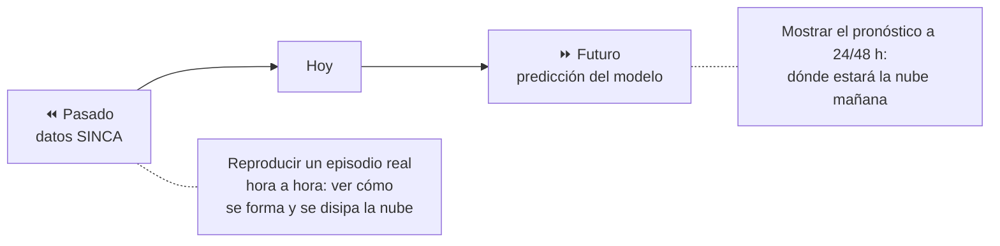

# Ideas para el panel de pronóstico (T10)

**Proyecto:** Predicción de episodios críticos de MP2.5 en el Gran Concepción
**Fecha:** 16 de noviembre de 2026
**Tarea de la Carta Gantt:** T10 (Panel), semanas S11–S13

Ideas anotadas antes de llegar a la T10, para no perderlas. No son compromisos.

---

## Idea 1: "Nube" de contaminación sobre el mapa 3D

### Qué es

Partir del mapa 3D ya construido (`extras/mapa_3d_estaciones.ipynb`: MapLibre + relieve + comunas + población) y dibujar sobre cada estación una **nube gris** que se oscurece y crece según su concentración de MP2.5.

### Formas de dibujarla

| Opción | Cómo se ve | Herramienta en MapLibre | Dificultad |
|---|---|---|---|
| 1. Nube por estación | Mancha gris difusa alrededor de cada pin; más grande y oscura con más MP2.5 | Capa `heatmap` con rampa de color blanco → gris oscuro | 🟢 Baja |
| 2. Columnas 3D | "Humo" vertical sobre cada estación, con altura según concentración | Capa `fill-extrusion` | 🟡 Baja-media |
| 3. Superficie continua | Capa gris que cubre toda la cuenca, interpolada entre estaciones | Interpolación (IDW o kriging) en Python → imagen o grilla | 🟠 Media-alta |

Escala de color sugerida, alineada con los niveles del D.S. N°12/2011:

| MP2.5 (24 h) | Nivel | Nube |
|---|---|---|
| < 50 | Bueno | Casi transparente |
| 50 – 79 | Regular | Gris claro |
| 80 – 109 | 🟡 Alerta | Gris medio |
| 110 – 169 | 🟠 Preemergencia | Gris oscuro |
| ≥ 170 | 🔴 Emergencia | Casi negro |

### Control deslizante de tiempo

- **Hacia atrás:** reproducir episodios históricos. Sirve para la defensa y para explicar el fenómeno.
- **Hacia adelante:** mostrar la salida del modelo (probabilidad de episodio a t+1 y t+2). Conecta directamente con el objetivo de la tesis.

### Precauciones

- ⚠️ **Zonas sin estación** (San Pedro de la Paz y Penco, ~200 mil habitantes): ahí la nube sería una **estimación**, no una medición. Distinguirlo visualmente (más transparente o achurado) y explicarlo en la leyenda.
- ⚠️ **Pronóstico vs. medición:** usar un estilo distinto para la nube pronosticada (por ejemplo, borde punteado) y mostrar la probabilidad, no solo el nivel.
- La red oficial para episodios es la **pública** (6 estaciones). Si el panel muestra las 18, indicarlo.

### Próximos pasos (cuando toque)

- [ ] Prototipo rápido de la opción 1 con un episodio real (un día de Alerta o superior).
- [ ] Decidir si el panel muestra datos horarios o diarios.
- [ ] Conectar con la salida de los modelos (T5–T8) para la parte de pronóstico.
- [ ] Combinar con la población por comuna: "personas bajo la nube".