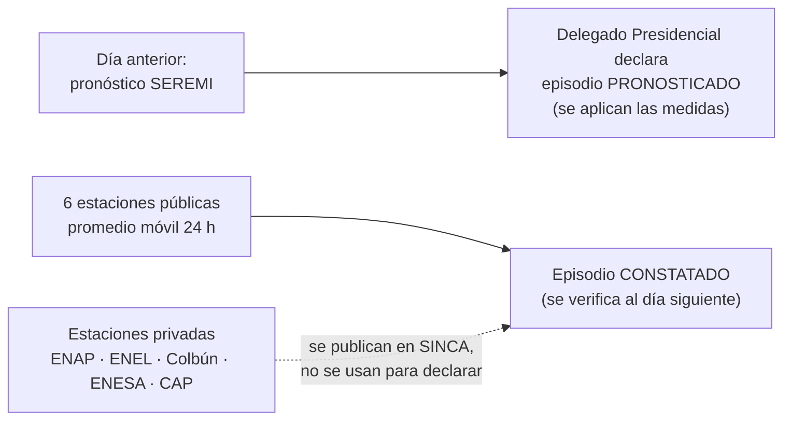
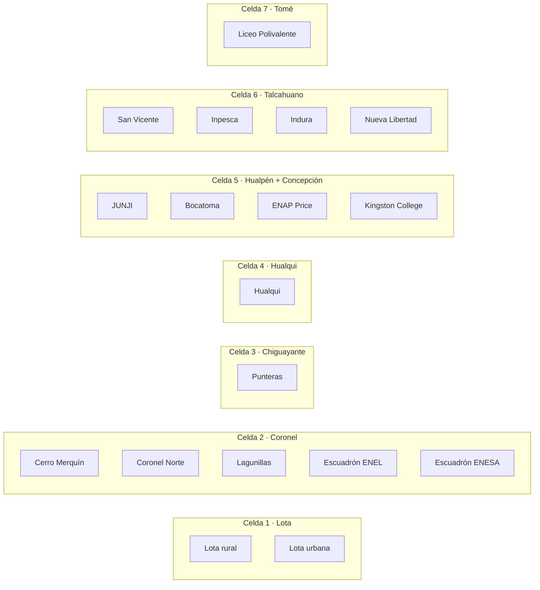

# Registro de decisiones: estaciones (T2) y meteorología (T3)

**Proyecto:** Predicción de episodios críticos de MP2.5 en el Gran Concepción
**Última actualización:** 16 de noviembre de 2026
**Tareas de la Carta Gantt:** T2 (Adquisición, depuración y clasificación SINCA) y T3 (Georreferenciación y capa meteorológica)

Este documento registra qué se corrigió, por qué y qué se decidió, para poder justificarlo en la tesis y reproducirlo.

| Tarea | Estado | Resultado principal |
|---|---|---|
| T2 · Datos SINCA | 🟡 En ampliación | 16 estaciones limpias, con coordenadas oficiales, comuna corregida y red registrada. **Se agregan** Liceo Polivalente de Tomé (830) y Nueva Libertad (837) → **18 estaciones** |
| T3 · Meteorología | ✅ Cerrada | Clima por estación en 6 celdas distintas; el viento es la variable que más distingue zonas |

---

## 1. Coordenadas de las estaciones

### Problema

14 de las 16 coordenadas de `UTM_ESTACIONES` eran aproximadas (marcadas "A" en el código). Al dibujarlas en un mapa aparecieron errores evidentes: Coronel Norte caía en el mar y las tres estaciones de Hualpén aparecían dentro de la comuna de Talcahuano.

### Solución

Se obtuvieron las coordenadas oficiales desde el listado de estaciones que usa el mapa de SINCA:

```
https://sinca.mma.gob.cl/index.php/json/listadomapa2k19/
```

Se convirtieron a UTM WGS84 huso 18S y se verificó, cruzándolas con los límites comunales, que **las 16 estaciones caen dentro de su comuna**.

### Magnitud del error corregido

| Estación | Error de la coordenada antigua |
|---|---|
| Coronel Norte | 🔴 12,5 km |
| Escuadrón ENESA | 🔴 8,4 km |
| Escuadrón ENEL | 🔴 6,0 km |
| Bocatoma | 🔴 5,8 km |
| Hualqui | 🟠 4,8 km |
| Cerro Merquín | 🟠 4,0 km |
| JUNJI | 🟠 3,9 km |
| ENAP Price | 🟠 3,9 km |
| Indura | 🟠 3,4 km |
| Lota rural | 🟠 2,7 km |
| Lagunillas ENEL | 🟡 1,9 km |
| Consultorio San Vicente | 🟡 1,2 km |
| Lota urbana | 🟢 0,4 km |
| Inpesca | 🟢 0,3 km |
| Punteras | 🟢 0,0 km (ya estaba verificada) |
| Kingston College | 🟢 0,0 km (ya estaba verificada) |

> 🔴 > 5 km · 🟠 2–5 km · 🟡 1–2 km · 🟢 < 1 km

**Consecuencia:** toda la meteorología descargada antes de esta corrección se pidió en ubicaciones equivocadas y se descargó de nuevo (sección 4).

---

## 2. Comuna de Lota rural

### Problema

En `config.py`, la estación Lota rural (859) estaba asignada a la comuna de **Coronel**.

### Por qué ocurrió

SINCA registra las dos estaciones de Lota (rural y urbana) en la comuna de "Coronel", porque pertenecen a la red **ENEL Coronel**. Es decir, SINCA usa el nombre de la red y no la ubicación geográfica. Al revisar el config se había corregido Lota urbana, pero Lota rural quedó con el dato de SINCA.

Con las coordenadas oficiales (-37,10; -73,16) se verificó que **Lota rural está dentro de la comuna de Lota**.

### Corrección

1. En `src/config.py`:
   ```python
   "859": ("Lota rural", "Lota"),
   ```
2. La columna `comuna` de los datos se escribe al descargar desde SINCA, copiando el config de ese momento. Por eso `crudo.parquet` seguía diciendo "Coronel" aunque se corrigiera el config.
   Para no volver a descargar, en `notebooks/02_limpieza.ipynb` la comuna **se reasigna siempre desde el config** al cargar el crudo:
   ```python
   comuna_de = {nombre: comuna for nombre, comuna in ESTACIONES.values()}
   datos["comuna"] = datos["estacion"].map(comuna_de)
   ```
3. Se regeneró `dataset_limpio.parquet`.

> **Regla adoptada:** `config.py` es la única fuente de verdad para nombre, comuna, coordenadas, red de cada estación y población por comuna.

---

## 3. Red de estaciones: pública, privada y episodios

### Hallazgo

El listado de SINCA indica quién opera cada estación (campos `calificacion` y `empresa`):

| Red | Operador | Estaciones |
|---|---|---|
| 🏛️ Pública | Ministerio del Medio Ambiente | Punteras, Kingston College, Cerro Merquín, Hualqui, Consultorio San Vicente, **Liceo Polivalente (nueva)** |
| 🏭 Privada | ENAP | JUNJI, Bocatoma, ENAP Price, Inpesca, Indura |
| 🏭 Privada | ENEL | Lagunillas, Escuadrón ENEL, Lota rural, Lota urbana |
| 🏭 Privada | Colbún | Coronel Norte |
| 🏭 Privada | ENESA | Escuadrón ENESA |
| 🏭 Privada | CAP (Siderúrgica Huachipato) | **Nueva Libertad (nueva)** |

Las estaciones privadas las instalan las empresas, normalmente por exigencia de su permiso ambiental, para medir el impacto de su operación. Sus datos se reportan a SINCA igual que los de la red pública.

### Cómo se declaran hoy los episodios en el Gran Concepción

**Resumen:** los episodios se gestionan **solo con la red pública del MMA** (6 estaciones con representatividad poblacional). Las estaciones privadas se publican en SINCA pero **no se usan** para declarar ni para constatar episodios.

#### ¿Quién, cuándo y con qué?

| Aspecto | Cómo funciona |
|---|---|
| **Período** | Gestión de Episodios Críticos (GEC): **1 de abril al 30 de septiembre** de cada año |
| **Quién declara** | El **Delegado Presidencial Regional**, con el apoyo de la **SEREMI del Medio Ambiente** |
| **Con qué declara** | Un **pronóstico** de calidad del aire elaborado el día anterior |
| **Con qué se verifica** | La medición de **alguna de las 6 estaciones públicas**, con **promedio móvil de 24 horas** de MP2.5 (o MP10) |
| **Dónde aplica** | Toda la zona saturada: las 10 comunas, aunque la superación ocurra en una sola estación |

#### Niveles de episodio para MP2.5 (D.S. N°12/2011)

| Nivel | Concentración 24 h | En nuestro proyecto |
|---|---|---|
| Bueno / Regular | < 80 µg/m³ | No episodio (la norma diaria es 50) |
| 🟡 **Alerta** | 80 – 109 µg/m³ | **Episodio crítico (objetivo a predecir: Alerta o superior)** |
| 🟠 **Preemergencia** | 110 – 169 µg/m³ | Episodio crítico |
| 🔴 **Emergencia** | ≥ 170 µg/m³ | Episodio crítico |

#### Episodio pronosticado vs. constatado



- **Pronosticado:** lo que la autoridad anuncia el día anterior y activa las medidas (restricción de leña, de industrias, etc.).
- **Constatado:** lo que efectivamente midieron las estaciones públicas. Es el registro oficial de si hubo episodio.

> 💡 **Relación con este proyecto:** nuestro modelo hace lo mismo que el **pronóstico** de la SEREMI (anticipar el episodio a 24/48 h). Para que sea comparable con la gestión oficial, el objetivo debería construirse con las **estaciones públicas**, igual que el episodio constatado.

#### Fuentes oficiales

| Fuente | Qué dice |
|---|---|
| D.S. N°6/2018 (PPDA Concepción Metropolitano) | La zona cuenta con una red pública de seis estaciones, en Coronel, Talcahuano, Concepción, Chiguayante, Hualqui y Tomé, con representatividad poblacional |
| Preguntas frecuentes PPDA (Municipalidad de Concepción / SEREMI MA) | El episodio **constatado** es el registrado al día siguiente por **alguna de las 6 estaciones**, con promedio móvil de 24 horas |
| Sitio Aire Concepción (MMA) | La GEC es declarada por el Delegado Presidencial Regional con el apoyo de la SEREMI del Medio Ambiente |
| Ord. N°1524/2026, SEREMI MA Biobío | La GEC 2026 rige del 1 de abril al 30 de septiembre |

#### Las 6 estaciones oficiales y nuestro dataset

| Estación pública | Comuna | Antes | Ahora |
|---|---|---|---|
| Cerro Merquín (831) | Coronel | ✅ | ✅ |
| Consultorio San Vicente (802) | Talcahuano | ✅ | ✅ |
| Kingston College (827) | Concepción | ✅ | ✅ |
| Punteras (854) | Chiguayante | ✅ | ✅ |
| Hualqui (841) | Hualqui | ✅ | ✅ |
| **Liceo Polivalente (830)** | **Tomé** | ❌ | ✅ **se agrega** |

Con la incorporación de Tomé, el dataset tiene **la red oficial completa**.

### Por qué importa

- Hoy el "episodio cuenca" se calcula como el **máximo de las 16 estaciones**, privadas incluidas. Esa definición marca **más episodios que los oficiales**.
- En el dataset 2017-2026, las estaciones privadas concentran cerca del **83% de los días-estación críticos**. Solo JUNJI, Coronel Norte e Inpesca suman cerca del 72%.
- La autoridad usa **promedio móvil de 24 horas**; nuestro dataset usa el **promedio diario** (00–23 h, mínimo 18 horas válidas). Hay que declararlo como diferencia metodológica o ajustarlo.

### Estaciones de la zona que no estaban en el dataset

**1. Búsqueda en el listado de SINCA** (16-nov-2026), filtrado por las 10 comunas: aparecieron 4 estaciones que no estaban en el dataset. (Las de Quillota que salen en el filtro, como "San Pedro", no son de la zona.)

**2. Revisión de funcionamiento:** se pidió el MP2.5 horario de 2017 a hoy a cada una, con `traer_estaciones` y sin guardar nada.

| Código | Estación | Comuna | Red / operador | Datos MP2.5 | Cobertura 2017–hoy | Decisión |
|---|---|---|---|---|---|---|
| **830** | Liceo Polivalente | Tomé | 🏛️ MMA (pública) | ✅ 2017-01-01 → hoy | **98%** | ✅ **Agregar** |
| **837** | Nueva Libertad | Talcahuano | 🏭 CAP (Siderúrgica Huachipato) | ✅ 2017-01-01 → hoy | **99%** | ✅ **Agregar** |
| 809 | Calabozo | Coronel | 🏭 Colbún | ❌ No mide MP2.5 | – | ❌ Descartar |
| 816 | Coronel Sur | Coronel | 🏭 Colbún | ❌ No mide MP2.5 | – | ❌ Descartar |

> *Cobertura = horas con dato / horas del período, antes de limpieza.*

**3. Lota rural (859):** no aparece en el listado del mapa de SINCA, pero **sigue entregando datos** (último dato: 15-nov-2026). Su cobertura es más baja (**63%**). Se mantiene en el dataset; su baja cobertura se considerará al decidir si tiene modelo local propio (`MIN_POSITIVOS_MODELO_LOCAL`).

**Resultado:** el dataset pasa de **16 a 18 estaciones** (6 públicas y 12 privadas).

**Estado de funcionamiento (16-nov-2026):** en la actualización del crudo (datos del 13 al 16 de noviembre) **las 18 estaciones entregaron MP2.5**. 16 de ellas tienen el período completo (~82 horas); Lota rural (67 h) y ENAP Price (76 h) tienen algunos huecos, pero siguen activas.

| Red | Estaciones |
|---|---|
| 🏛️ Pública (6) | Punteras, Kingston College, Cerro Merquín, Hualqui, Consultorio San Vicente, **Liceo Polivalente** |
| 🏭 Privada (12) | ENAP (5) · ENEL (4) · Colbún (1) · ENESA (1) · **CAP (1): Nueva Libertad** |

> ⚠️ **Sub-zona de Tomé:** Tomé no está en ninguna de las 3 sub-zonas definidas a priori (Coronel-Lota, Talcahuano-Hualpén, valle). Hay que decidir con el equipo si se suma a una existente o queda como sub-zona propia. Nueva Libertad entra en **Talcahuano-Hualpén**.

### Opciones para el análisis

| Opción | Qué predice | Ventaja | Riesgo |
|---|---|---|---|
| A. Todas las estaciones | Episodios en cualquier punto medido | Más datos y más episodios para entrenar | No coincide con lo que declara la autoridad |
| B. Solo red pública (6, con Tomé) | Episodios como los constata la SEREMI | Comparable con la gestión oficial | Menos episodios para entrenar |
| C. Ambas | Objetivo principal con una, la otra como comparación | Cubre las dos lecturas | Más trabajo en T8 |

**Propuesta:** opción C, con la **red pública como objetivo principal** (es la que tiene relevancia para la gestión) y todas las estaciones como análisis complementario. Decisión pendiente del equipo.

### Decisión tomada hasta ahora

Se registró la red de cada estación en `config.py` (`RED_ESTACIONES` y `ESTACIONES_PUBLICAS`) para poder filtrar en cualquier etapa.

### Plan para incorporar las 2 estaciones

Se hará en tres pasos, probando cada uno antes de seguir.

**Paso 1 · Documentar** ✅

**Paso 2 · Código**

| Archivo | Cambio |
|---|---|
| ✅ `src/config.py` | Agregar 830 y 837 a `ESTACIONES`, `UTM_ESTACIONES` (coordenadas oficiales SINCA → UTM 18S) y `RED_ESTACIONES` |
| ✅ `notebooks/01_descarga.ipynb` | Detecta estaciones del config que no están en el crudo y baja su **historial completo** (desde 2011); luego actualización normal |
| ✅ `notebooks/02_limpieza.ipynb` | Sin cambios de código; se volvió a correr (18 estaciones) |
| ✅ `notebooks/03_meteo.ipynb` | Mismo mecanismo: baja la meteo completa de las estaciones nuevas (desde 2017) y regenera informe y maestro |
| ⏳ `extras/mapa_3d_estaciones.ipynb` | Agregar las 2 estaciones a `SUBZONAS`; Tomé deja de estar en gris |

> 💡 **Lección: el kernel guarda el config viejo.** En el notebook 02 las estaciones nuevas no aparecían porque el kernel tenía en memoria el `ESTACIONES` de 16; la comuna quedaba vacía y `pivot_table` descartaba esas filas sin avisar. **Después de editar `config.py`, reiniciar el kernel (botón Restart), no solo Run All.**
>
> ⚠️ **Por qué la descarga va aparte:** `actualizar_estaciones` solo baja datos **desde la última fecha guardada** en el parquet. Si se agregan las estaciones al config y se corre tal cual, de las nuevas solo bajarían los últimos 3 días. Lo mismo aplica a la meteorología.

**Paso 3 · Probar**
- [x] El crudo tiene 18 estaciones (MP2.5: Tomé 101.834 h, Nueva Libertad 137.848 h desde 2011).
- [x] El dataset limpio tiene 18 estaciones. Cobertura MP2.5 2017+: Liceo Polivalente 98%, Nueva Libertad 99%.
- [x] El informe de resolución incluye a las 2: Tomé en celda propia (7), Nueva Libertad en la celda 6.
- [ ] El mapa 3D muestra los 2 pines nuevos y Tomé con color.

---

## 4. Meteorología (T3)

### 4.1 Problema

El proyecto compara modelos para toda la cuenca con modelos por sub-zona y por estación. Para que esa comparación tenga sentido, cada estación debería recibir **su propio clima**. La meteorología descargada tenía tres problemas:

1. **Coordenadas equivocadas:** se pidió con las coordenadas aproximadas (sección 1).
2. **El código agrupaba estaciones:** `traer_meteo` redondeaba cada estación a una cuadrícula de 0,25° (unos 25 km) y descargaba una sola serie por cuadro. Las 16 estaciones quedaban en 3 puntos (uno de ellos en el mar), así que muchas recibían **exactamente la misma serie**.
3. **La fuente tiene resolución limitada:** los modelos meteorológicos dividen el territorio en cuadros de varios kilómetros. Estaciones cercanas pueden caer en el mismo cuadro aunque se pida la coordenada exacta.

Si todas las estaciones reciben el mismo clima, un modelo local no puede aprender nada meteorológico propio de su zona, lo que limita la conclusión principal del proyecto. El anteproyecto reconoce este riesgo (sección 3.3) y pide un "informe de resolución espacial" como entregable de T3.

### 4.2 Fuente de los datos

Los datos se obtienen con la **Historical Weather API de Open-Meteo**. Open-Meteo es el servicio que entrega los datos; los datos provienen de modelos del ECMWF:

| Modelo | Resolución | Disponible desde |
|---|---|---|
| ECMWF IFS HRES | 9 km | 2017 |
| ERA5 | 0,25° (~25 km) | 1940 |
| ERA5-Land | 0,1° (~9-11 km) | 1950 |

Con el modo por defecto (`best_match`), Open-Meteo combina estos tres modelos y elige el de mayor resolución disponible. Como el período del proyecto parte en 2017, la mayor parte de los datos proviene del IFS de 9 km. **Los resultados lo confirman:** las celdas asignadas están separadas por unos 8 km (sección 4.6).

Cada respuesta de la API informa el **centro de la celda de la grilla que se usó**, que puede estar a algunos kilómetros del punto pedido.

### 4.3 Decisiones

**Modelo: `best_match`** (`METEO_MODELO = None` en el config)

| Opción | Ventaja | Desventaja |
|---|---|---|
| ✅ `best_match` (elegida) | Mayor resolución: lo que más ayuda a distinguir estaciones | Mezcla de modelos; no se sabe cuál se usó en cada momento |
| `era5` | Una sola fuente, consistente en todo el período | 25 km: las estaciones quedarían casi todas con el mismo clima |
| `era5_land` | ~9 km | No trae viento ni precipitación propios; el viento es clave para los episodios |

Open-Meteo recomienda ERA5 o ERA5-Land para estudios de cambio climático de varias décadas. Este proyecto no estudia tendencias de largo plazo: necesita distinguir estaciones dentro de 2017-2026, por lo que se prioriza la resolución. En la metodología se declara como: *"Open-Meteo Historical Weather API, modo best_match (ECMWF IFS 9 km desde 2017, complementado con ERA5/ERA5-Land)"*.

**Selección de celda: `land`** (`METEO_CELDA = "land"` en el config)

Open-Meteo busca una celda de tierra con elevación similar al punto pedido. Se elige porque varias estaciones están en la costa (Talcahuano, Coronel, Lota) y, con la celda más cercana, podrían quedar asociadas a un cuadro sobre el mar.

### 4.4 Cambios en el código

| Archivo | Cambio | Estado |
|---|---|---|
| `src/config.py` | Fuente documentada, `METEO_MODELO`, `METEO_CELDA`, corrección de Lota rural | ✅ |
| `requirements.txt` | Se agrega `openpyxl` para exportar el informe a Excel | ✅ |
| `src/meteo.py` | Clima en la coordenada exacta de cada estación, sin agrupar en cuadros de 0,25° | ✅ |
| `src/meteo.py` | Guarda la celda usada (`celda_lat`, `celda_lon`, `celda_elev`) y la coordenada pedida (`lat_estacion`, `lon_estacion`) | ✅ |
| `src/meteo.py` | Corrección del parámetro `params["models"]` (decía `"model"`) | ✅ |
| `src/meteo.py` | Nueva función `informe_resolucion()` | ✅ |
| `notebooks/03_meteo.ipynb` | Genera el informe y lo guarda en `data/informes/informe_resolucion_meteo.xlsx` | ✅ |
| `src/meteo.py` | Detectar automáticamente meteorología antigua (`_meteo_vigente`) | ⏸️ No aplicado: se borraron a mano los parquet antiguos y se descargó todo de nuevo |

> ⚠️ **Nota sobre `celda_elev`:** Open-Meteo devuelve la elevación **del punto pedido** (modelo digital de 90 m), no la de la celda. El nombre correcto sería `elev_punto`; cambio opcional pendiente.

### 4.5 Cómo leer el informe de resolución

El informe tiene tres tablas:

- **Estaciones:** qué celda usó cada estación y a cuántos kilómetros quedó del punto pedido.
- **Celdas:** qué estaciones comparten celda. Las estaciones de una misma celda reciben (casi) **la misma serie de clima**.
- **Variables:** cuán parecidas son las series entre celdas (correlación entre pares) para temperatura, viento, altura de capa límite y humedad.

Interpretación:

- Si hay varias celdas distintas y correlaciones claramente menores que 1, la meteorología **sí distingue** entre estaciones o zonas.
- Si casi todas las estaciones comparten celda o las correlaciones son cercanas a 1, la meteorología **no distingue** entre estaciones. No es una falla: se reporta como **condicionante del estudio**, como prevé el anteproyecto.

### 4.6 Resultados del informe de resolución

> ℹ️ Resultados con las **18 estaciones** (incluye Tomé y Nueva Libertad, incorporadas el 16-nov-2026).

#### Antes vs. ahora

| Indicador | Antes (cuadrícula 0,25°) | Ahora (por estación) | Cambio |
|---|---|---|---|
| Puntos / celdas distintas | 3 (uno en el mar) | **7** (todas en tierra) | ×2,3 |
| Distancia mediana estación–celda | 10,3 km | **3,3 km** | −68% |
| Distancia máxima estación–celda | 14,0 km | **8,8 km** | −37% |

#### Celdas asignadas

Las 18 estaciones quedan repartidas en 7 celdas, de sur a norte:

| Celda | Centro (lat, lon) | Estaciones | Sub-zona(s) |
|---|---|---|---|
| 1 | -37,083; -73,118 | Lota rural, Lota urbana | Lota |
| 2 | -37,012; -73,140 | Cerro Merquín, Coronel Norte, Lagunillas ENEL, Escuadrón ENEL, Escuadrón ENESA | Coronel |
| 3 | -36,942; -73,043 | Punteras | Chiguayante |
| 4 | -36,942; -72,925 | Hualqui | Hualqui |
| 5 | -36,801; -73,088 | JUNJI, Bocatoma, ENAP Price, Kingston College | Hualpén + **Concepción** |
| 6 | -36,731; -73,110 | Consultorio San Vicente, Inpesca, Indura, **Nueva Libertad** | Talcahuano |
| **7** | – | **Liceo Polivalente** | **Tomé** (celda propia) |



**Lectura:**
- **Tomé tiene celda propia** (celda 7), así que aporta clima distinto al resto. Nueva Libertad comparte la celda 6 con las demás de Talcahuano.
- Las celdas calzan casi exactamente con las sub-zonas. La única mezcla es la **celda 5**: Kingston College (Concepción) comparte clima con las estaciones ENAP de Hualpén.
- La separación entre celdas es de unos 8 km, lo que confirma que los datos vienen principalmente del **IFS de 9 km**.

#### Distancia de cada estación a su celda

| Estación | Celda | Distancia |
|---|---|---|
| Inpesca | 6 | 🟢 0,85 km |
| Coronel Norte | 2 | 🟢 0,90 km |
| **Nueva Libertad** | 6 | 🟢 0,93 km |
| Cerro Merquín | 2 | 🟢 1,32 km |
| Consultorio San Vicente | 6 | 🟢 1,46 km |
| Punteras | 3 | 🟡 2,18 km |
| Bocatoma | 5 | 🟡 2,90 km |
| ENAP Price | 5 | 🟡 3,00 km |
| Lota urbana | 1 | 🟡 3,29 km |
| Lagunillas ENEL | 2 | 🟡 3,29 km |
| JUNJI | 5 | 🟡 3,38 km |
| Kingston College | 5 | 🟡 3,71 km |
| **Liceo Polivalente** | 7 | 🟡 3,75 km |
| Lota rural | 1 | 🟡 3,94 km |
| Hualqui | 4 | 🟡 3,99 km |
| Indura | 6 | 🟠 4,31 km |
| Escuadrón ENEL | 2 | 🔴 6,52 km |
| Escuadrón ENESA | 2 | 🔴 8,83 km |

> 🟢 < 2 km · 🟡 2–4 km · 🟠 4–5 km · 🔴 > 5 km
>
> Las dos estaciones Escuadrón quedan lejos de su celda. Se puede probar `cell_selection="nearest"` para ver si les asigna una celda más cercana (pendiente opcional).

#### ¿El clima cambia entre celdas?

| Variable | Series distintas | Correlación mediana | Correlación mínima | Lectura |
|---|---|---|---|---|
| Temperatura | 10 | 0,971 | 0,947 | ⚪ Casi igual en toda la cuenca |
| Capa límite | 8 | 0,962 | 0,906 | ⚪ Casi igual en toda la cuenca |
| Humedad | 10 | 0,896 | 0,769 | 🟡 Diferencias moderadas |
| **Viento** | 7 | **0,898** | **0,578** | 🟢 **Diferencias reales entre zonas** |

> Con 16 estaciones la correlación mediana del viento era 0,935; al sumar Tomé baja a **0,898**. Tomé aporta un régimen de viento distinto al del resto de la cuenca.

```
Correlación mínima entre celdas (más bajo = más diferencia)
Temperatura  ███████████████████▏ 0,947
Capa límite  ██████████████████▏  0,906
Humedad      ███████████████▍     0,769
Viento       ███████████▌         0,578
```

**Conclusiones:**

1. **El viento es la variable que más distingue zonas.** Al menos un par de celdas tiene correlación de solo 0,58 (probablemente Hualqui, en el interior, contra la costa). Esto justifica haber pasado de 3 puntos a 7 celdas.
2. **Temperatura y capa límite son prácticamente comunes a toda la cuenca.** Es coherente con que los episodios de MP2.5 respondan a condiciones regionales (inversión térmica, calma) que afectan a todo el Gran Concepción a la vez. Esto respalda mantener el **modelo agregado** como base.
3. **Hay más series que celdas** en temperatura y humedad (10 series con 7 celdas) porque Open-Meteo corrige esas variables según la altura de cada punto. Estaciones de una misma celda a distinta altura reciben valores levemente distintos. No es un error.

**Párrafo para la tesis (borrador):**

> *La meteorología se obtuvo por estación desde Open-Meteo (best_match, predominantemente ECMWF IFS 9 km). Las 18 estaciones quedaron asociadas a 7 celdas de grilla, con una distancia mediana de 3,3 km entre estación y centro de celda. La temperatura y la altura de capa límite presentan correlaciones superiores a 0,9 entre todas las celdas, por lo que actúan como forzantes comunes de la cuenca; el viento es la variable con mayor diferenciación espacial (correlación mínima de 0,58). En consecuencia, la diferenciación entre modelos locales provendrá principalmente del viento y de la historia de MP2.5 de cada estación. Se reconoce como limitación que una resolución de 9 km no capta efectos locales de valle ni de borde costero, y que series distintas no implican series más exactas.*

---

## 5. Población expuesta por comuna (mapa 3D)

Se agregó al mapa 3D (`extras/mapa_3d_estaciones.ipynb`) la población de cada comuna de la zona saturada, para dimensionar a cuántas personas afecta un episodio. Al hacer clic en una comuna se ve su población y su número de estaciones; el panel muestra el total.

El dato vive en `src/config.py` como `POBLACION_COMUNA`, para poder reutilizarlo en el análisis y en el panel (T10).

**Fuente:** Censo de Población y Vivienda 2024 (INE), tomado de los Reportes Comunales de la Biblioteca del Congreso Nacional (BCN).

| Comuna | Habitantes (Censo 2024) | Estaciones | |
|---|---|---|---|
| Concepción | 230.375 | 1 | ████████████████████████ |
| San Pedro de la Paz | 150.992 | **0** ⚠️ | ████████████████ |
| Talcahuano | 147.322 | 3 → **4** (se agrega la 837) | ███████████████▍ |
| Coronel | 123.648 | 5 | █████████████ |
| Hualpén | 87.731 | 3 | █████████▏ |
| Chiguayante | 85.822 | 1 | █████████ |
| Tomé | 56.907 | 0 → **1** (se agrega la 830) | ██████ |
| Penco | 48.971 | **0** ⚠️ | █████▏ |
| Lota | 39.980 | 2 | ████▏ |
| Hualqui | 25.795 | 1 | ██▊ |
| **Total zona saturada** | **997.543** | **16 → 18** | |

**Observaciones:**

- Casi **1 millón de personas** viven en la zona saturada.
- **San Pedro de la Paz** es la segunda comuna más poblada y **no tiene estación**. Junto con Tomé y Penco suman **256.870 habitantes (26%) sin medición en el dataset original**.
- **Con Tomé (830) incorporada**, la población sin estación baja a **199.963 habitantes (20%)**: San Pedro de la Paz y Penco, que no tienen estación en SINCA.
- La distribución de estaciones no sigue a la población: Coronel tiene 5 estaciones (casi todas privadas, por las termoeléctricas) y Concepción, la comuna más poblada, tiene 1.

---

## 6. Pendientes

**T2 y T3**
- [x] Incorporar 830 y 837 en descarga, limpieza y meteorología.
- [ ] Incorporar 830 y 837 en el mapa 3D.
- [x] Coordenadas oficiales y comuna de Lota rural corregidas.
- [x] Red pública/privada registrada en el config.
- [x] Meteorología por estación descargada y consolidada.
- [x] Informe de resolución generado e interpretado.
- [x] Población por comuna agregada al config y al mapa 3D.
- [ ] *(Opcional)* Renombrar `celda_elev` a `elev_punto`.
- [ ] *(Opcional)* Probar `cell_selection="nearest"` para las estaciones Escuadrón.
- [ ] *(Opcional)* Agregar la protección `_meteo_vigente` en `actualizar_meteo`.

**Para conversar con el equipo (cierra T1)**
1. [ ] Mantener las 3 sub-zonas definidas a priori.
2. [ ] Usar la división por comuna como análisis de sensibilidad en T8.
3. [ ] Red de estaciones para el objetivo: todas, solo pública o ambas (sección 3, opciones A/B/C).
   - [x] Tomé (830) y Nueva Libertad (837): activas, se agregan.
   - [x] Calabozo (809) y Coronel Sur (816): no miden MP2.5, se descartan.
   - [x] Lota rural (859): sigue activa, se mantiene (cobertura 63%).
   - [ ] Sub-zona de Tomé: sumarla a una existente o dejarla propia.
   - [ ] Definir si el episodio se calcula con promedio diario o móvil de 24 h.
4. [ ] Agregar un modelo global agrupado como comparador extra.

**Siguiente**
- [ ] Cerrar T1: congelar `SUBZONAS` y `MIN_POSITIVOS_MODELO_LOCAL` en el config y completar el documento de esquema predictivo.
- [ ] T4: notebook 04 con el dataset de modelado (target t+1 y t+2, lags, diccionario).

---

## Fuentes

- SINCA, listado de estaciones: <https://sinca.mma.gob.cl/index.php/json/listadomapa2k19/>
- Open-Meteo, Historical Weather API: <https://open-meteo.com/en/docs/historical-weather-api>
- Open-Meteo, integración de ECMWF IFS 9 km desde 2017: <https://openmeteo.substack.com/p/processing-90-tb-historical-weather>
- Ministerio del Medio Ambiente, Plan Operacional GEC Concepción Metropolitano 2026: <https://ppda.mma.gob.cl/wp-content/uploads/2026/04/PLAN-OPERACIONAL_GEC_CM_2026.pdf>
- BCN, Reportes Comunales (Censo 2024, INE): <https://www.bcn.cl/siit/reportescomunales/>
- D.S. N°6/2018, PPDA Concepción Metropolitano (Ley Chile): <https://www.bcn.cl/leychile/Navegar/imprimir?idNorma=1140121>
- Municipalidad de Concepción, preguntas frecuentes del PPDA: <https://concepcion.cl/plandescontaminacion/>
- MMA, Aire Concepción, preguntas frecuentes: <https://aireconcepcion.mma.gob.cl/preguntas-frecuentes/>
- SEREMI MA Biobío, Ord. N°1524/2026, inicio GEC 2026: <https://ppda.mma.gob.cl/wp-content/uploads/2026/03/Ord.-N°-1524_2026-Informa-Inicio-GEC_PPDACM-2026.pdf>
- SEREMI MA Biobío, preguntas frecuentes PPDA: <https://calefaccionsustentable.mma.gob.cl/wp-content/uploads/2020/08/Preguntas-Frecuentes-PPDA-Concepcion-Metropolitano.pdf>